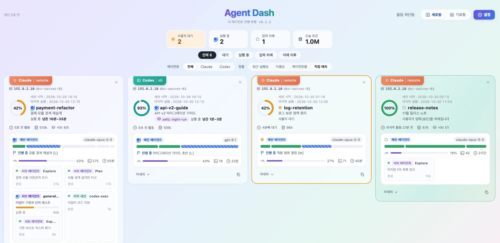
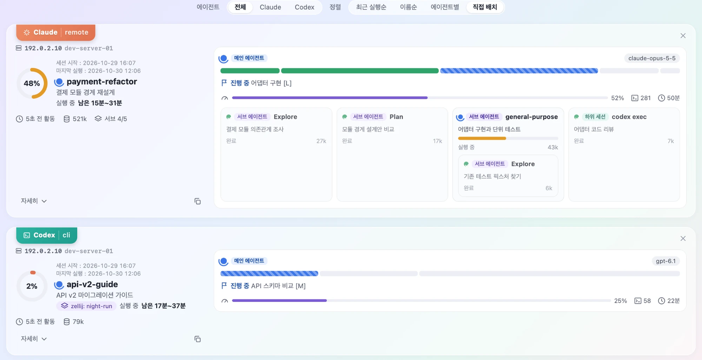
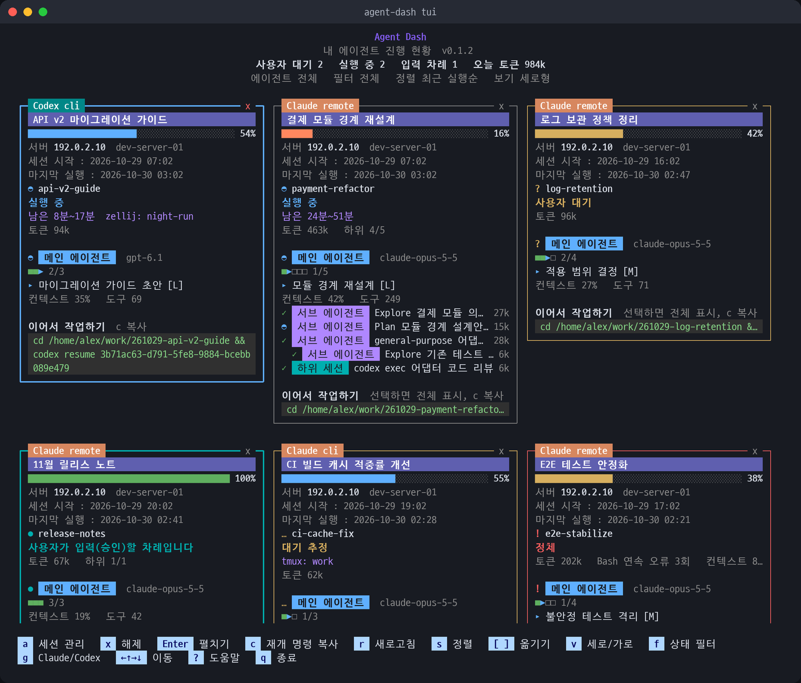

# agent-dash

English | [한국어](README_ko.md)

A personal dashboard that shows the progress of your Claude Code and Codex sessions on one screen

- Web view and terminal view (TUI)
- Built for running many agent tasks in parallel

## Screenshots

> All sessions, paths and server addresses in the screenshots are sample values. The UI is currently in Korean.

**Web, grid view**



**Web, list view**



**Terminal view (TUI)**



## Features

- **Session cards**
  - Progress, estimated time left, plan steps
  - Main agent, subagents, child sessions (`claude -p`, `codex exec`)
  - Token usage, context usage
  - Resume command to pick up the work the next day
- **Status**
  - Running, waiting for user, user's turn to reply or approve, stalled, running in background
  - Cards waiting for your reply get a slowly moving background
- **Where it runs**
  - Launch mode: remote (an app connected over SSH) or cli (started in a terminal on the server)
  - Server IP
  - Terminal multiplexer: tmux, zellij, screen, cmux, herdr
- **Views**
  - Sort: recent activity, name, agent, custom order
  - Drag cards to reorder
  - Filter by Claude or Codex
  - Grid or list layout

## Data handling

- Only reads the log files Claude and Codex already write
- No hooks, plugins or skills installed. No extra tokens used
- Reads only the sessions you track
- Never collects, stores or shows what you type (requests, answers, rejection reasons)
- Shows only the titles and summaries that Claude or Codex generated
- The web server listens on `127.0.0.1` only

## Install

```bash
curl -fsSL https://raw.githubusercontent.com/nota-github/agent-dash/main/install.sh | sh
```

- Run it on the server where your agents run
- Requires Python 3.9 or later (no other packages)
- Operating systems
  - Linux: supported and tested
  - macOS: expected to work but not tested yet. Process and multiplexer info is not shown
  - Windows: not supported (WSL not tested)
- The installer asks for
  - View: web, terminal (TUI), or both
  - Web port: picks a free port in 24000-25000 automatically; asks you if none is free
- Install locations
  - Code: `~/.local/share/agent-dash`
  - Command: `~/.local/bin/agent-dash`
  - Settings and tracked sessions: `~/.agentdash`
- Does not edit shell startup files. If `~/.local/bin` is not on your PATH, it shows how to add it
- Non-interactive install

  ```bash
  curl -fsSL https://raw.githubusercontent.com/nota-github/agent-dash/main/install.sh | AGENT_DASH_MODE=both AGENT_DASH_PORT=24500 sh
  ```

- Korean installer messages: use `install_ko.sh` instead of `install.sh`. The language is kept for updates

## Supported setups

| Setup | Support | Where to install, how to connect |
|---|---|---|
| 1. Claude or Codex apps on your local PC | Next version (Mac) | |
| 2. Local apps connected to a remote server over SSH | Yes | Install on the server. Open the web view through an SSH tunnel |
| 3. CLI over SSH on a remote server | Yes | Install on the server. Web view through an SSH tunnel, TUI in the SSH session |

## Tracking sessions

- Nothing is shown right after install
- Track the sessions you want to see. Only tracked sessions are read

| How | Track | Untrack |
|---|---|---|
| Web view | Top right 설정 > 세션 관리, then 등록 next to a session | x at the top right of a card, or 등록됨 in 세션 관리 |
| Terminal view | `a` (session list), pick a session, `Enter` | Select a card and press `x`, or `Enter` in the session list |
| Command | `agent-dash track <session ID prefix>` | `agent-dash untrack <session ID prefix>` |

```bash
agent-dash sessions                 # recent sessions and their IDs (* = tracked)
agent-dash track 3b71ac63           # track by session ID prefix
agent-dash track --dir ~/work/api   # track every session under this folder, including future ones
```

- Subagents and child sessions (`claude -p`, `codex exec`) appear inside the parent card without tracking them
- Untracked sessions stay at the top of the session list, so you can track them again
- The web view and the terminal view share the same tracked list

## Usage

```bash
agent-dash start      # start the web server (background)
agent-dash stop       # stop the web server
agent-dash restart    # restart the web server
agent-dash status     # install info, web server state, port, tracked sessions
agent-dash tui        # terminal view (q quit, ? key help)
```

- No need to run it inside tmux or zellij
  - The web server runs in the background and keeps running after you close SSH
  - After the server reboots, run `agent-dash start` again
- Opening the web view on a remote server
  - Open an SSH tunnel from your PC, then browse to `http://localhost:<port>`
  - `agent-dash start` prints the tunnel command with your user, address and SSH port filled in

    ```bash
    ssh -f -N -L <port>:127.0.0.1:<port> <user>@<server>
    ```

  - `-f`: the tunnel stays open after you close the terminal
  - To reconnect automatically, use `autossh -M 0 -f -N -L ...`
- More details (Korean): [MANUAL.md](MANUAL.md)

## Changing the port

```bash
agent-dash status                                  # current port
AGENT_DASH_PORT=24600 agent-dash update --force    # reinstall with port 24600
```

- Reinstalls the same version on the new port. Tracked sessions and other settings are kept
- A running web server is restarted on the new port
- Reopen the SSH tunnel on your PC with the new port
  - Close the old tunnel: `pkill -f "<old port>:127.0.0.1:<old port>"`
  - `agent-dash start` prints the new tunnel command
- If the port is in use, the installer stops and tells you. Run again with another number
- Use a number from 1024 to 65535 that no other program uses

## Update

```bash
agent-dash update                  # update to the latest version
agent-dash update --mode both      # change the view type
```

- Keeps your view type, port, language and tracked sessions
- A running web server is restarted after the update
- Running the install command (`curl ... | sh`) again does the same
- New version notice
  - Shown when you run `agent-dash`, and at the top of the web and terminal views
  - Checks once a day by downloading one version file from GitHub (nothing is sent)
  - To turn it off: add `"update_check": false` to `~/.agentdash/config.json`
- Changes: [CHANGELOG.md](CHANGELOG.md)

## Uninstall

```bash
agent-dash uninstall                  # restore the state before install
agent-dash uninstall --purge-backup   # also delete the rollback backup
```

- Every installed file is recorded; uninstall follows the record in reverse
- Shared folders such as `~/.local/bin` are removed only if empty

## Development

```bash
python3 -m unittest discover -s tests
./install.sh          # from a clone, installs the code in this folder
```
